<div align="center">

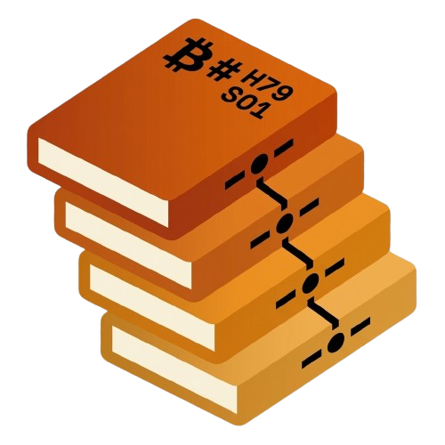

# SatoWiki

**The Orange Book of Bitcoin.**

An open-source, offline-first Bitcoin encyclopedia for iOS and Android:<br>
wiki, history timeline, BIP tracker and Bitcoin Core release notes, in English and Italian.

[](https://github.com/Dado-hash/Sato-Wiki/actions/workflows/flutter.yml)
[](LICENSE)
[](LICENSE-CONTENT)


[Features](#features) ·
[Screenshots](#screenshots) ·
[Getting started](#getting-started) ·
[How content works](#how-content-works) ·
[Contributing](#contributing)

<br>

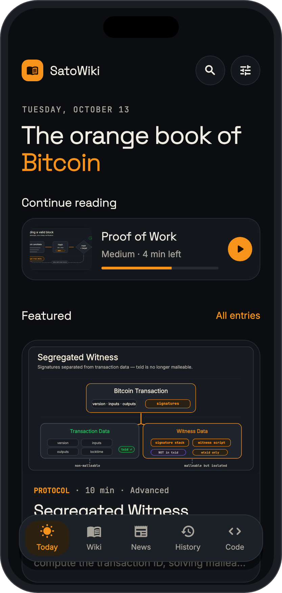
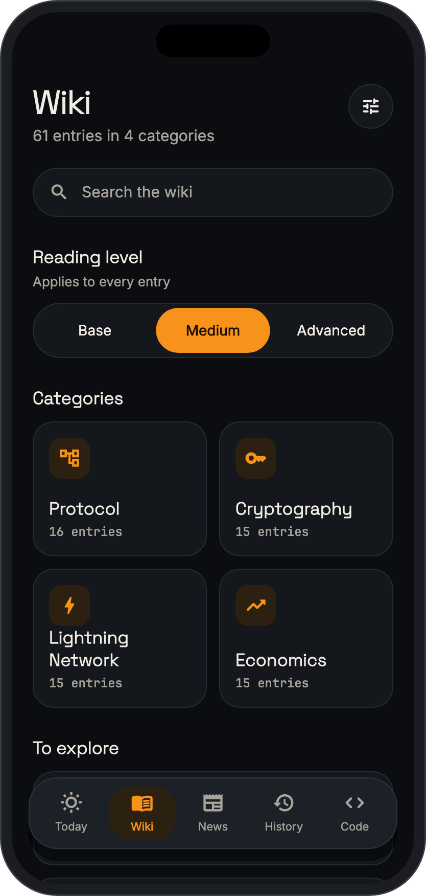
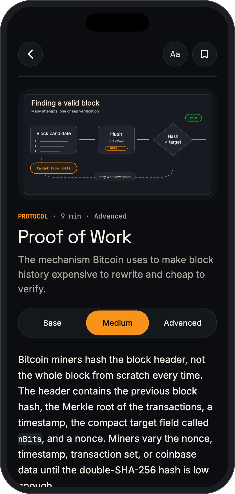
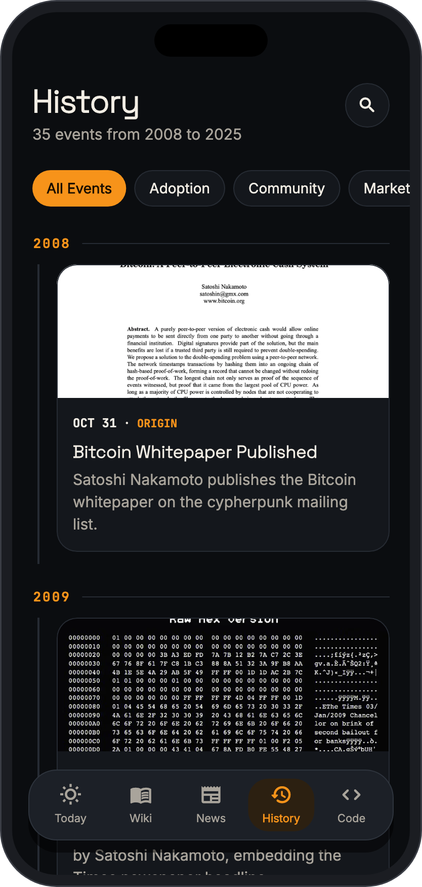
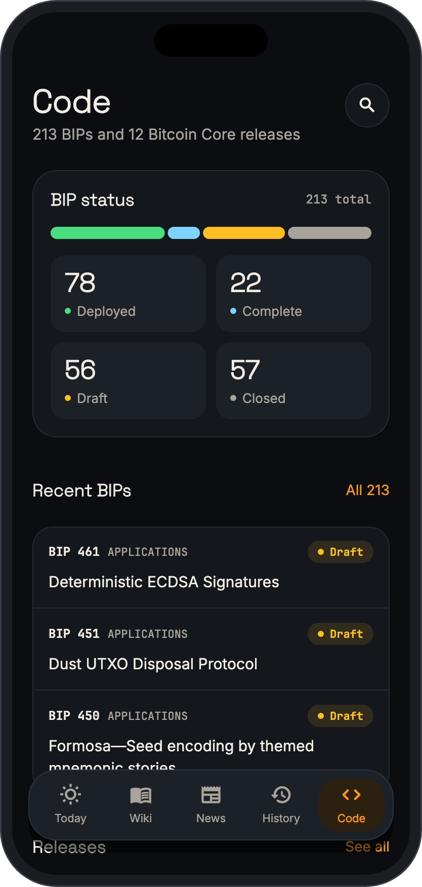

</div>

## What is SatoWiki?

Learning Bitcoin usually means jumping between a wiki, a mailing list archive, the BIPs repository and release notes written for people who already know the codebase. SatoWiki puts them in one app and explains each topic at the depth you choose.

Everything you read is stored on the device. The app opens and works with no connection, has no account, and ships no analytics. The content itself lives in this repository, so every entry can be reviewed, corrected and improved with a pull request.

> **Status:** beta. The app is not on the App Store or Google Play yet. You can build it from source in a few minutes.

## Features

- **Wiki with three reading levels.** Every entry is written three times: Base, Medium and Advanced. Each level stands on its own, so you never need the advanced text to follow the basic one.
- **History timeline.** The events that shaped Bitcoin, from the 2008 whitepaper to today, with sources and images.
- **BIP tracker.** More than 200 Bitcoin Improvement Proposals with status, authors, a plain-language summary and what each one changes in practice.
- **Bitcoin Core releases.** Release notes rewritten twice: what changes for users, and what changed technically.
- **Offline first.** A content bundle ships inside the app. Updates are downloaded in the background, checked against a SHA-256 hash and validated before they replace anything.
- **Bilingual.** Interface and content in English and Italian, switchable at any time.
- **Private by default.** No account, no analytics, no ads. Bookmarks and reading progress never leave the device. See the [privacy policy](docs/privacy-policy.md).
- **Comfortable reading.** Dark and light themes, adjustable text size, bookmarks, reading progress and search across every section.

## Screenshots

<div align="center">
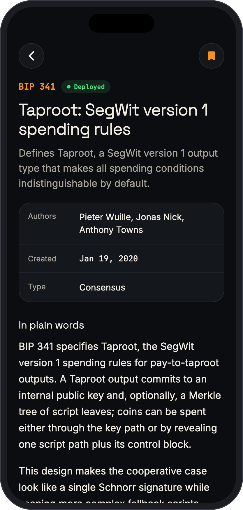
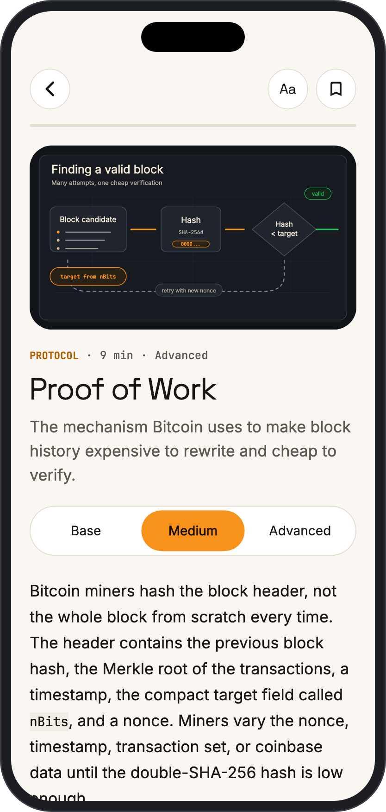
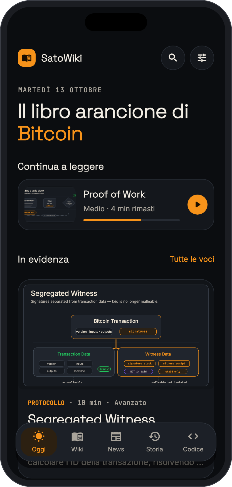
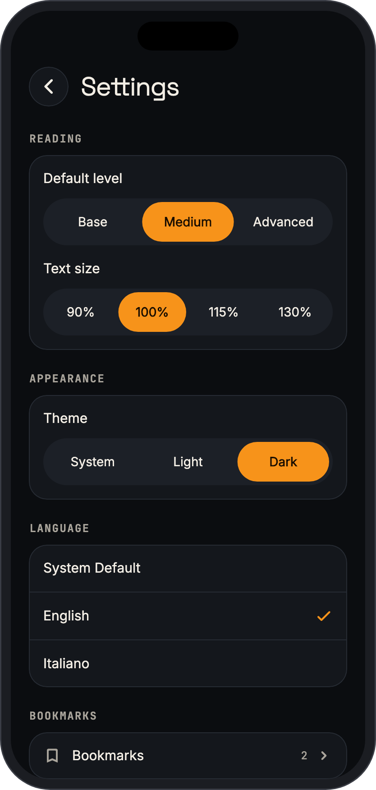
<br>
<sub>BIP detail · light theme · Italian · settings</sub>
</div>

<br>

The screenshots are rendered from the real app and the real content bundle by a script, so they can be regenerated after a UI change:

```bash
flutter test tool/readme_screenshots_test.dart
```

## Getting started

You need [Flutter](https://docs.flutter.dev/get-started/install) 3.32 or later (Dart 3.8), plus Xcode for iOS or Android Studio for Android.

```bash
git clone https://github.com/Dado-hash/Sato-Wiki.git
cd Sato-Wiki
flutter pub get
flutter run
```

No API keys, Firebase project or signing setup are needed to run the app.

Before opening a pull request, run the same checks as CI:

```bash
dart format lib test tool
flutter analyze
flutter test
dart run tool/validate_content.dart assets/content/seed_bundle_en.json
dart run tool/validate_content.dart assets/content/seed_bundle_it.json
```

## How content works

Content is plain data, kept apart from the app code. Each language has one JSON bundle holding every record: wiki entries, news, history events, BIPs and release notes.

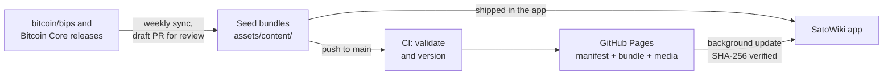

- The app always starts from the bundle it already has. The network is never needed to show content.
- When online, it reads a small manifest from GitHub Pages. If a newer version exists, it downloads the bundle and its media, verifies the hash, validates the schema and only then installs it.
- A weekly job reads new BIPs and Bitcoin Core release notes, drafts the English and Italian texts with an LLM and opens a draft pull request. Nothing generated is published before a human review.

The full data contract is in [docs/content-model.md](docs/content-model.md), and the contributor workflow is in [docs/contributing-content.md](docs/contributing-content.md).

## Project structure

```text
lib/src/
  core/        content loading and updates, navigation, search, settings, theme, shared widgets
  features/    today, wiki, news, history, code, search, settings
assets/
  content/     seed bundles (en, it) and media
  fonts/       Space Grotesk, Inter, JetBrains Mono
content/       Markdown sources and templates for wiki and history
tool/          content validation, bundle generation, upstream sync, screenshots
test/          widget, unit and golden tests
docs/          architecture, content model, design system, guidelines
```

## Documentation

| Document | What it covers |
| --- | --- |
| [App architecture](docs/app-architecture.md) | Routing, state, offline-first loading, search |
| [Content model](docs/content-model.md) | The data contract for every record type |
| [Contributing content](docs/contributing-content.md) | Writing, validating and publishing content |
| [Design system](docs/design-system.md) | Theme, tokens, components and UI rules |
| [Development guidelines](docs/development-guidelines.md) | Code style, accessibility and testing |
| [Roadmap](docs/roadmap.md) | What is done and what comes next |
| [Licensing](docs/licensing.md) | Licenses for code, content and bundled fonts |

Some documents are still written in Italian. Translations are welcome.

## Contributing

Contributions of every size are welcome, and you do not need to write Dart to help:

- **Fix or improve an entry.** Found an error, a dead source or an unclear explanation? Open an issue or a pull request.
- **Write or translate content.** Every record exists in both English and Italian.
- **Improve the app.** Bug fixes, accessibility and performance work are all useful.

Start with [CONTRIBUTING.md](CONTRIBUTING.md). By taking part you agree to follow the [Code of Conduct](CODE_OF_CONDUCT.md). To report a security problem, see [SECURITY.md](SECURITY.md).

## License

- **Code** is released under the [MIT License](LICENSE).
- **Editorial content and documentation** are released under [CC BY-SA 4.0](LICENSE-CONTENT).
- **Bundled fonts** (Space Grotesk, Inter, JetBrains Mono) keep their SIL Open Font License. See [assets/fonts/NOTICE.md](assets/fonts/NOTICE.md).

SatoWiki is an independent community project. It is educational material, not financial advice.
